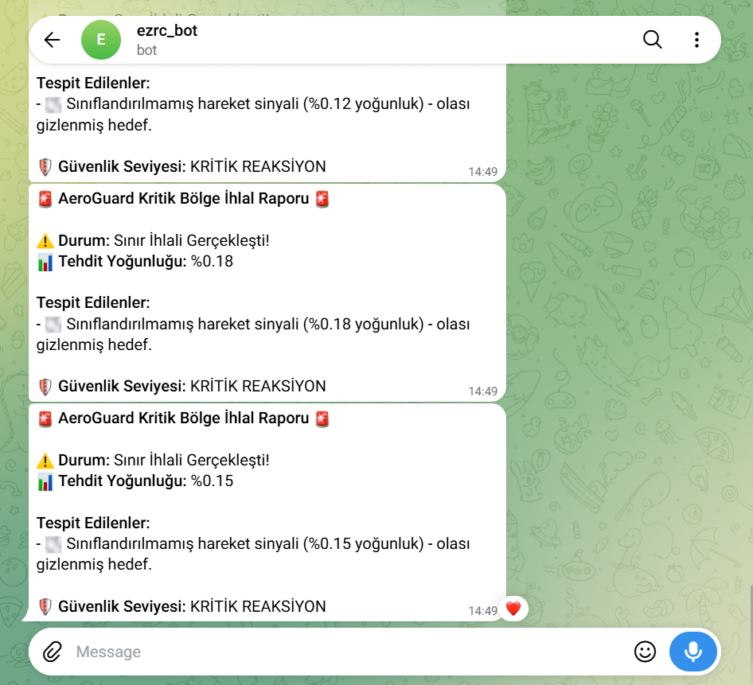
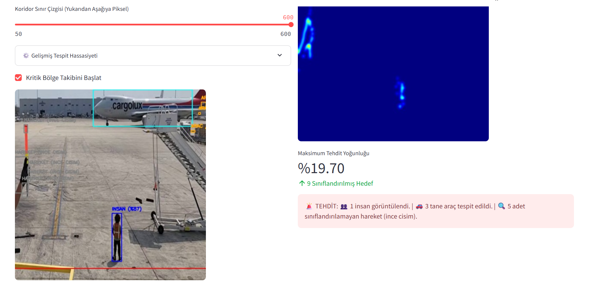
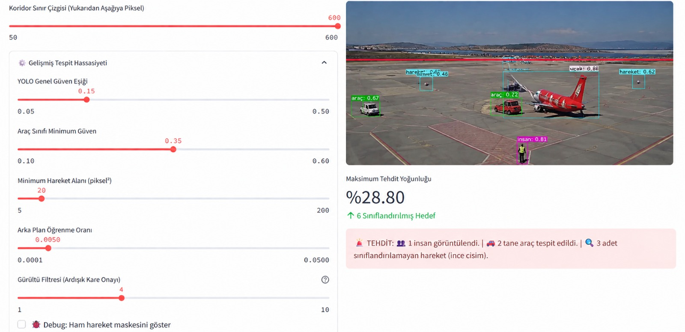

# AeroGuard EdgeAI 

AeroGuard; RGB kamera görüntüsü, hareketten türetilen yardımcı termal/risk kanalı, özel sensör-füzyon autoencoder'ı ve YOLOv8 nesne tespitini birleştirerek kritik bir koruma bölgesindeki insan, araç ve diğer hareketleri gerçek zamanlı analiz eden EdgeAI prototipidir.

## Mimari

- **Girdi:** RGB (3 kanal) + yardımcı termal/hareket (1 kanal), toplam 4 kanal, 640×640
- **Fusion Encoder:** RGB ve termal için ayrı özellik çıkarım kolları, ardından özellik birleştirme ve 128 boyutlu latent vektör
- **Fusion Decoder:** latent vektörden 4 kanallı sahne rekonstrüksiyonu
- **Nesne tespiti:** YOLOv8m; insan ve araç sınıfları için ayrı güven filtreleri
- **Hareket analizi:** MOG2 + morfolojik temizleme + kontur analizi
- **Alarm doğrulama:** güvenilir YOLO tespitleri anlık; sezgisel hareket adayları ardışık kare filtresinden geçer
- **Arayüz:** Streamlit

> Not: Mevcut eğitilmiş encoder/decoder ağırlıklarıyla uyumluluk korunmuştur. Decoder'ın 4. kanalı yardımcı termal kanaldır; hibrit görsel ekranda yalnızca ilk 3 RGB kanal gösterilir.

## Kurulum

Python 3.10 veya 3.11 önerilir.

```bash
python -m venv .venv
# Windows
.venv\\Scripts\\activate
pip install -r requirements.txt
streamlit run app.py
```

## Kullanım

Arayüzden web kamerası, yerel MP4 veya RTSP kaynağı seçilebilir. Test için `data/test_drone.mp4` kullanılabilir. Koruma çizgisi, YOLO güven eşiği, araç güven eşiği, minimum hareket alanı, arka plan öğrenme oranı ve ardışık kare doğrulaması arayüzden ayarlanabilir.

## Eğitim

Eğitim görüntülerini `data/train_images/` içine yerleştirin ve:

```bash
python src/train.py
```

Kayıplar 4 kanallı rekonstrüksiyon için MSE ve RGB kanalları için SSIM bileşimidir. Son ağırlıklar `weights/encoder_ssim.pth` ve `weights/decoder_ssim.pth` olarak kaydedilir.

## ONNX Dönüşümü

```bash
python src/optimize.py
```

Bu işlem mevcut `weights/encoder_ssim.pth` dosyasını kullanarak `weights/fusion_encoder.onnx` üretir.

## Telegram Bildirimi

Güvenlik nedeniyle bot anahtarı kaynak kodda tutulmaz. Bildirim kullanılacaksa işletim sistemi ortam değişkenlerinde `TELEGRAM_BOT_TOKEN` ve `TELEGRAM_CHAT_ID` tanımlanmalıdır. `.env.example` yalnızca alan adlarını gösterir.

## Teknik Tasarım Gerekçesi

Encoder'daki stride=2 konvolüsyonlar uzamsal çözünürlüğü kontrollü azaltırken kanal sayısını artırarak daha soyut özelliklerin temsil edilmesini sağlar. BatchNorm eğitim kararlılığını destekler; ReLU düşük hesap maliyeti ve kararlı gradyan akışı nedeniyle EdgeAI hedefi için tercih edilmiştir. YOLO ve hareket tabanlı ikinci yolun birlikte kullanılması, yalnızca sınıflandırıcıya veya yalnızca piksel hareketine bağımlılığı azaltır. Ardışık kare doğrulaması tek karelik gürültülerin alarm üretmesini sınırlar.

## Güvenlik Notu

Kaynak kodun önceki sürümünde gömülü bulunan Telegram kimlik bilgileri kaldırılmıştır. Daha önce kullanılan gerçek bot token'ı artık gizli kabul edilmemeli; Telegram/BotFather üzerinden yenilenmesi önerilir.

## Sistemden Görüntüler

### Telegram Kritik Bölge İhlal Bildirimi


### Canlı Tespit ve Termal Görüntü


### Tehdit Yoğunluğu ve Sınıflandırılmış Hedefler

